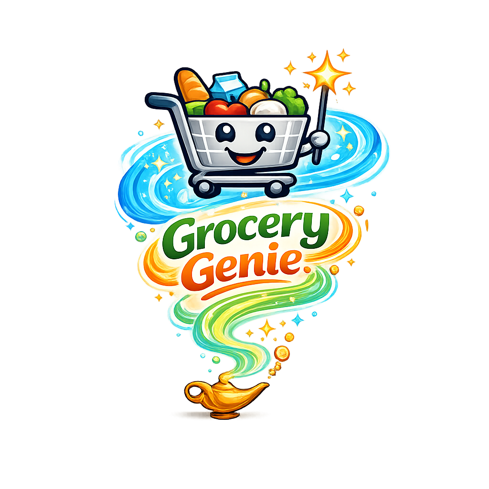
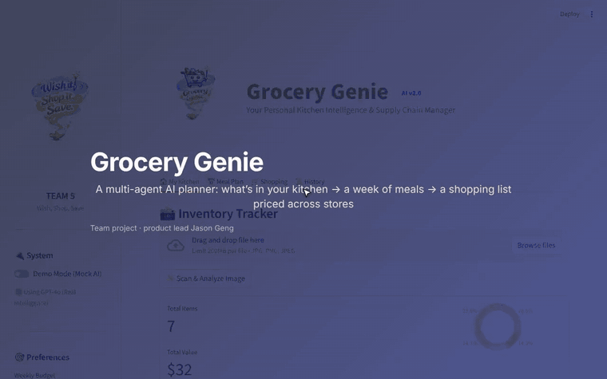
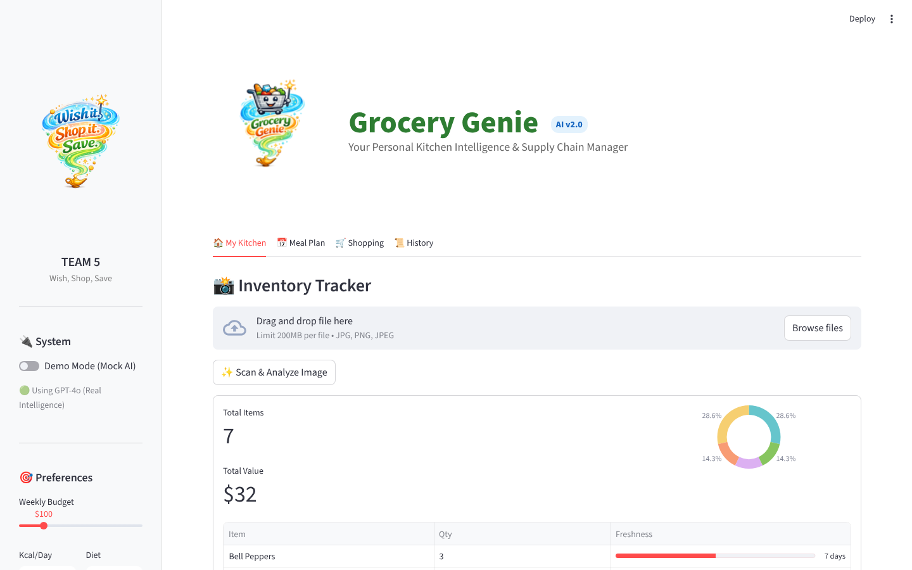
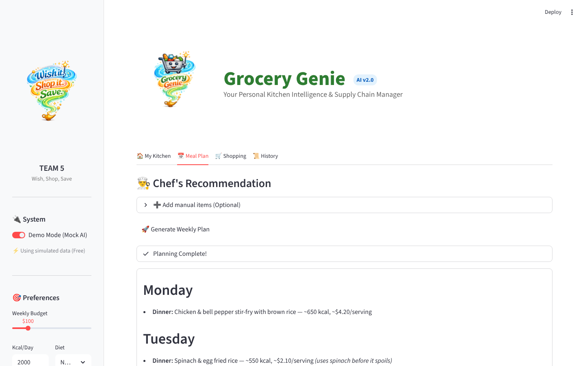
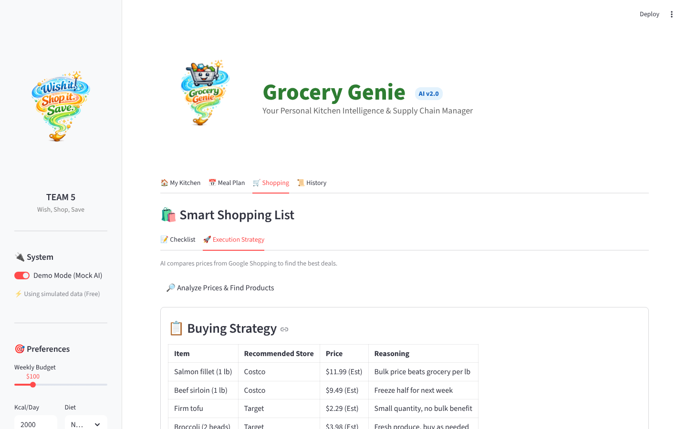

<p align="center">
  
</p>

<h1 align="center">Grocery Genie</h1>

<p align="center">
  <b>An AI kitchen assistant that turns what's already in your fridge into a weekly meal plan, a de-duplicated shopping list, and a cheapest-store buying strategy.</b><br>
  Multi-agent LLM pipeline · GPT-4o vision · live price search · linear-programming budget optimizer
</p>

<p align="center">
  
  
  
  
  
</p>


<p align="center">
  <a href="docs/demo.mp4"></a><br>
  <sub>Walkthrough: kitchen inventory → AI meal plan within budget → shopping list → cheapest-store buying strategy (demo mode). ▶ <a href="docs/demo.mp4">Full video with captions (MP4, 70 s)</a></sub>
</p>

---

## The problem

Weekly grocery planning is three chores that people do separately and badly:

1. **Remembering what you already have** — so food spoils and duplicates get bought.
2. **Planning meals** that fit a budget, a calorie target and a diet.
3. **Deciding where to buy** — bulk at Costco vs. convenience at Target, with prices that change weekly.

Existing apps solve one piece (recipe apps, list apps, price trackers). Grocery Genie connects them into one flow, with the household's **current inventory as the starting point** rather than a blank recipe search.

**Target user:** a budget-conscious household (students, young families) that shops weekly and wants to cut food waste and spend without spending an hour planning.

## How it works

| Step | What the user does | What the AI does |
|---|---|---|
| **1. Stock the kitchen** | Snap a photo of the fridge or a receipt | GPT-4o vision extracts items, quantity, cost and an estimated shelf life; inventory shows freshness bars so "use soon" items stand out |
| **2. Plan the week** | Set budget, calories/day, diet, cuisines | Meal-planning agent builds a 7-day plan that **uses expiring inventory first**; a linear-programming model independently checks the cheapest calorie-feasible meal mix |
| **3. Build the list** | — | Shopping-list agent consolidates duplicate ingredients; inventory agent subtracts what you already own |
| **4. Decide where to buy** | Tap *Analyze Prices* | Live Google Shopping prices (SerpAPI) are fed to a store-optimization agent that recommends Costco vs. Target per item and totals the bill |
| **5. Learn over time** | Save the run | Plans, strategies and totals are stored in a history tab |

<p align="center">
  <br>
  <sub>Inventory with freshness tracking — the starting point for every plan</sub>
</p>

<p align="center">
  <br>
  <sub>Weekly plan generated by the agent chain</sub>
</p>

<p align="center">
  <br>
  <sub>Per-item store recommendation and total cost</sub>
</p>

## Product decisions & trade-offs

**Agents in a chain, not one big prompt.** Planning, list extraction, inventory reconciliation and store optimization are four narrow agents. Each has one job and a strict output format, which made failures easy to locate and fix one at a time (e.g. the list agent's prompt was tightened to force ingredient consolidation) and lets any step be swapped for a cheaper model later.

**LLM for preferences, math for the budget.** LLMs are good at "Asian food, vegetarian, kid-friendly" and unreliable at arithmetic. So the budget feasibility check is a PuLP integer-programming model (minimize cost subject to calorie bounds), shown next to the LLM plan instead of trusting the LLM's own totals.

**Never show "N/A".** When live search misses an item, the store agent must estimate a price and label it *(Est)*. A shopping total with gaps is useless to the user; a clearly-labelled estimate is still actionable.

**Demo Mode as a first-class feature.** A mock LLM returns step-appropriate responses so the whole flow runs offline with no API key. This kept development and demos free, made the app usable when quota ran out, and lets anyone evaluate the product in under a minute.

**Cost awareness built in.** `token_tracker.py` counts tokens per call (tiktoken) to estimate spend per plan — the input for deciding which steps justify GPT-4o and which can run on a smaller model.

## What I'd measure next

The project is a working prototype; it has not been tested with real households. If taken further, these are the metrics I'd instrument:

| Goal | Metric |
|---|---|
| Reduce waste | % of "use soon" inventory items that appear in the generated plan |
| Save money | Plan total vs. user's stated budget; estimated vs. actual receipt total |
| Trust the AI | Edit rate on generated plans and lists; vision extraction accuracy vs. a labelled set of receipts |
| Keep it cheap | Tokens and $ per completed plan, by model |
| Retention | Weekly plans generated per household over 4 weeks |

## My role

Two-person team project, early 2026.

- **Jennifer Sun** built the first version: Streamlit app skeleton, the meal-planning and shopping-list agents, the LP optimizer, mock LLM and token tracker.
- **Jason Geng (me)** took it from prototype to the current product:
  - Designed the end-to-end user flow and the four-tab UI (Kitchen → Meal Plan → Shopping → History) and the brand
  - Built the **fridge/receipt vision scan** (GPT-4o, structured JSON output) and the freshness-based inventory dashboard
  - Built **live price search** and the **store-optimization agent** (Costco vs. Target split, forced estimates, totals)
  - Added the **inventory reconciliation agent** so users only buy what they don't have
  - Added saved run history and the Gmail e-receipt sync prototype
  - Later: cleaned up the repo, fixed price rendering, made Demo Mode cover the full flow

## Run it locally

```bash
git clone https://github.com/jasonmayg/grocery-genie.git
cd grocery-genie
python3 -m venv venv && source venv/bin/activate
pip install -r requirements.txt
streamlit run app.py
```

Turn on **Demo Mode** in the sidebar to try the whole flow without any API key.

To use real AI and live prices, copy the templates and add your own keys:

```bash
cp .env.example .env                                   # OPENAI_API_KEY
cp .streamlit/secrets.toml.example .streamlit/secrets.toml   # OPENAI_API_KEY, SERPAPI_KEY
```

## Project structure

```
app.py                 Streamlit UI and orchestration of the agent chain
agents.py              Meal-plan, shopping-list, inventory-check, store-optimization agents
vision_agent.py        GPT-4o image → inventory JSON
price_fetcher.py       Google Shopping prices via SerpAPI
ml_optimizer.py        PuLP integer program: cheapest calorie-feasible meal mix
llm_config.py          Real model vs. mock model switch
mock_llm.py            Offline mock used by Demo Mode
token_tracker.py       Token and cost estimates per call
db.py, init_db.py      SQLite schema (inventory, recipes, history)
data/                  Recipe dataset used for the recipe database
```

## Known limitations

- Gmail receipt sync is a **prototype** that parses a sample e-receipt; it does not connect to a real inbox yet.
- Per-product calorie figures on the product cards are placeholders.
- The LP optimizer uses a small built-in meal table rather than the full recipe database.

---

© 2026 Jason Geng and Jennifer Sun. Shared for portfolio review. All rights reserved.
